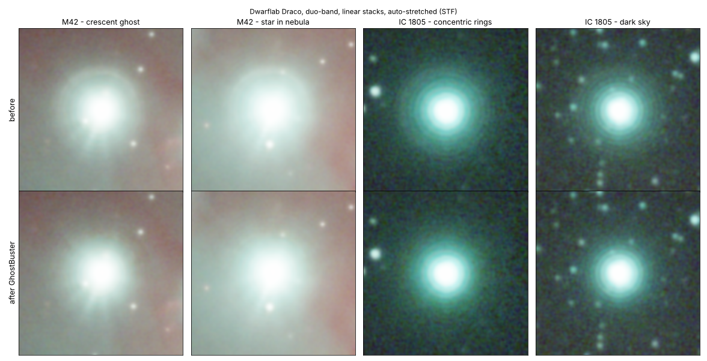
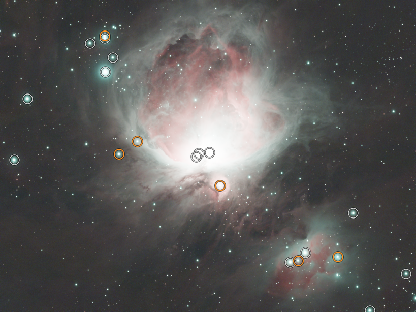

# GhostBuster

[](https://github.com/Jiness/GhostBuster/actions/workflows/ci.yml)
[](https://github.com/Jiness/GhostBuster/actions/workflows/codeql.yml)

A PixInsight script that removes the **reflection ghost rings** around bright stars,
the sharp-edged disks and crescents you get on **Dwarflab Draco** duo-band stacks
(and, in principle, on other instruments with internal reflections).

Star removal tools (StarXTerminator, Halo-B-Gone...) do not recognise these ghosts
as part of the star, so they stay in the starless image and come back with every stretch.
GhostBuster models them on the linear data and subtracts them before star removal.



## What the ghost is

Part of the light of a bright star bounces between two surfaces close to the sensor
(sensor cover glass and/or the duo-band filter) and lands out of focus, as a filled disk
with a sharp edge, slightly off-centre. Measured on Draco duo-band stacks (native, 1.45"/px):

- edge radius about 30 to 35 px, a few px off-centre, so it often shows as a **crescent**;
- intensity about 0.1 to 0.3 % of the star;
- **redder than the star** (red about 1.3 to 1.7 x, green and blue about 0.7 to 0.9 x).

It is different from the wide, soft scattered-light halo of the star, which GhostBuster does not remove.

## Installation

1. Download `GhostBuster.js` from the [latest release](https://github.com/Jiness/GhostBuster/releases/latest) into a folder of your choice
   (or `git clone https://github.com/Jiness/GhostBuster.git`).
2. In PixInsight: **Script > Feature Scripts... > Add**, select that folder, **Done**.
3. The script appears in **Script > Utilities > GhostBuster**.

(You can also run it once with **Script > Run Script File...**.)

## Where it goes in your processing

Linear data only:

```
Stack -> crop -> background extraction (GraXpert / DBE) -> GhostBuster -> SPCC -> BlurXTerminator -> NoiseXTerminator -> StarXTerminator -> stretch
```

The hard rules: **linear**, **before BlurXTerminator**, **before StarXTerminator**.

## Usage



The script first analyses the image (nothing is modified), then shows it with a circle around each candidate star:

| Circle | Meaning |
|---|---|
| **White** | will be corrected |
| **Orange** | uncertain (bright nebula or weak ghost), corrected only if you click it |
| **Grey** | excluded by you |
| **Green** | star you added (click a star that has no circle) |

- Click a circle to switch it on/off; click a green circle to remove it.
- Mouse wheel or **+ / -** to zoom, drag to move around, **Fit** to see the whole image.
- **Execute** creates `<image>_deghosted` and (optional) `<image>_ghost`, the part that was removed.
  The original image is never modified.

**Automated mode** (default) reads the pixel scale from the header (astrometric solution,
else pixel size and focal length, else image size) and derives every setting, so 2x drizzled
images work too. **Manual mode** exposes all settings.

## How it works

1. **Candidate stars.** Stars with a saturated core.
2. **Learning.** On stars in dark sky, the script measures for the current image the radial shape
   of the ghost, the typical ghost-to-star ratio and the ghost colour relative to the star.
3. **Per-star analysis.** The smooth stellar halo and the local background (quadratic surface) are
   modelled; what is left in the annulus is the ghost signal, with neighbouring stars masked. The
   learned shape is fitted to it (radius adjusted per star, limited lopsidedness) and refined by a
   bounded free correction. The ghost colour is the star colour, measured near the core, times the
   learned colour ratio. A confidence value compares the ghost strength with the structure around it.
4. **Subtraction.** The freedom of the model follows the confidence: a strong, clear ghost gets a
   free shape and colour, which removes off-centre crescents; a weak ghost in structured nebula is
   limited to a regular ring, which avoids digging holes in the nebula.

## Limitations

- Tuned and tested on Dwarflab Draco duo-band stacks (M42, IC 1805, Eastern and Western Veil).
  Other instruments: the ghost shape is learned from the image, but this is untested.
- Stars buried in bright, structured nebula are ambiguous; that is why they are shown in orange.
- The wide scattered-light halo of very bright stars is not removed (it is not a ghost).

## Tests

The processing core has no PixInsight dependency and can be tested with Node.js (no image data needed):

```
node tests/run_tests.js
node tests/ui_test.js
```

The tests build synthetic star fields with known ghosts and check detection, ghost removal,
manual star handling, parameter validation and robustness to invalid input. A second set runs the
whole script, dialog included, against a minimal simulation of the PixInsight scripting API.
They do not replace a check inside PixInsight itself.

### Benchmark on real stacks

`bench/run_bench.js` runs the processing core on your own FITS stacks, as the automated mode does,
and writes for each image a contact sheet (raw | corrected, brightest stars) and per-star figures:

```
node bench/run_bench.js "path/to/folder/with/fits" --out bench-results
```

Results go to `bench-results/v<version>/` (`report.md`, `results.json` and one PNG per image).
Only the contact sheets and figures are written; the FITS files and their headers stay on your
machine. Published results: [bench-results](bench-results/).

## License

Copyright (C) 2026 Jiness.
Released under the **GNU General Public License v3.0 or later** (see [LICENSE](LICENSE)).
You can use, modify and share it freely; modified versions you distribute must stay open source under the same license.

