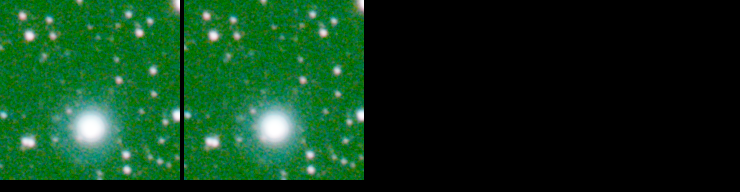
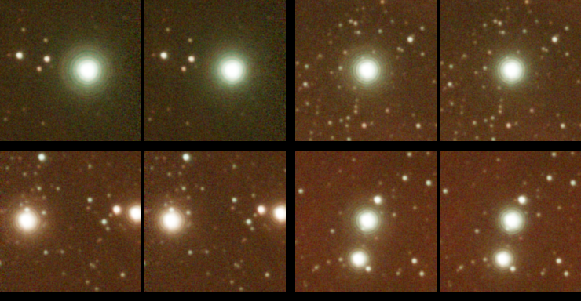
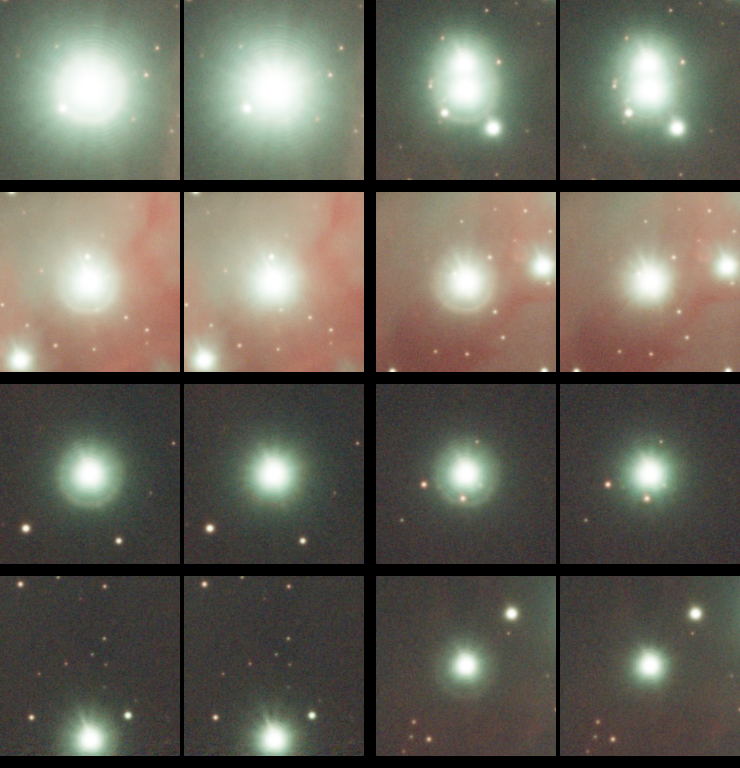
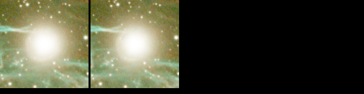

# GhostBuster 0.1.6 - benchmark on real stacks

Automated mode, default selection (white stars).
Figures in the ghost zone (22-40 px at the reference scale). Real stacks have no ground truth: these
figures describe what the correction did and are meant for comparison between versions; the contact
sheets are the reference.

- **removed**: light removed, % of the light above the local background
- **uneven**: spread of the removed light over 8 sectors, (max - min) / mean in %; 0 = round ghost, large = lopsided
- **colour**: largest change of a channel share between raw and corrected (points)

## DRACO RAW Estern Veil Nebula 36x300s 

4096 x 3072, 3 channel(s); scale 1.00 (astrometric solution (1.45"/px)); 9 candidate stars, 1 corrected in 1.0 s.

Contact sheet: the 1 largest corrected stars, raw | corrected, two per row, in the order of the table.

| # | star (x, y) | confidence | removed % | uneven % | colour pts |
|---|---|---|---|---|---|
| 1 | (1298, 50) | 2.1 | 9.7 | 4.3 | 0.3 |

## DRACO RAW IC 1805 36x300s

4096 x 3072, 3 channel(s); scale 1.00 (pixel size and focal length (1.45"/px)); 16 candidate stars, 4 corrected in 1.8 s.

Contact sheet: the 4 largest corrected stars, raw | corrected, two per row, in the order of the table.

| # | star (x, y) | confidence | removed % | uneven % | colour pts |
|---|---|---|---|---|---|
| 1 | (4027, 802) | 4.6 | 20.5 | 65.9 | 0.4 |
| 2 | (2375, 2117) | 4.8 | 31.9 | 35.7 | 2.5 |
| 3 | (32, 2647) | 2.4 | 19.6 | 100.0 | 1.9 |
| 4 | (131, 1481) | 5.0 | 15.5 | 95.3 | 1.1 |

## DRACO RAW M 42 36x300s_Duo-Band

4096 x 3072, 3 channel(s); scale 1.00 (astrometric solution (1.45"/px)); 20 candidate stars, 8 corrected in 2.6 s.

Contact sheet: the 8 largest corrected stars, raw | corrected, two per row, in the order of the table.

| # | star (x, y) | confidence | removed % | uneven % | colour pts |
|---|---|---|---|---|---|
| 1 | (1035, 2364) | 13.2 | 22.5 | 60.9 | 1.6 |
| 2 | (1031, 2695) | 8.2 | 1.9 | 153.4 | 0.2 |
| 3 | (3003, 587) | 3.5 | 15.2 | 148.2 | 1.3 |
| 4 | (2856, 493) | 5.9 | 22.8 | 157.3 | 0.7 |
| 5 | (269, 2101) | 6.6 | 20.5 | 71.1 | 0.6 |
| 6 | (138, 1499) | 5.3 | 19.6 | 70.5 | 1.5 |
| 7 | (3639, 16) | 3.7 | 20.3 | 190.0 | 1.3 |
| 8 | (884, 2648) | 3.5 | 29.5 | 57.8 | 0.7 |

## DRACO RAW Veil Nebula_31x300s120_Duo-Band

4096 x 3072, 3 channel(s); scale 1.00 (astrometric solution (1.45"/px)); 4 candidate stars, 1 corrected in 0.7 s.

Contact sheet: the 1 largest corrected stars, raw | corrected, two per row, in the order of the table.

| # | star (x, y) | confidence | removed % | uneven % | colour pts |
|---|---|---|---|---|---|
| 1 | (1672, 2324) | 7.0 | 9.2 | 109.1 | 2.5 |

